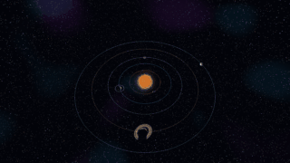

# Proyecto 3 — Sistema solar "Aurelia"

Simulación de un sistema solar inventado, dibujado con un **software renderer en CPU** escrito en
Rust. No se usa OpenGL, Vulkan ni ningún motor: la ventana (`minifb`) solo recibe un arreglo de
píxeles que calcula nuestro propio pipeline (vertex shader → recorte → rasterización → z-buffer →
fragment shader). El proyecto parte del renderer y de los shaders procedurales del Laboratorio 6.



## Video del recorrido

Vuelo por el sistema Aurelia: acercamiento a los planetas, warp entre cuerpos y vuelta alrededor de ellos.

[](https://youtu.be/TWcWKBT_UZo)

▶️ **[Ver en YouTube](https://youtu.be/TWcWKBT_UZo)**

---

## El sistema

Todos los cuerpos orbitan sobre el **plano eclíptico** (y = 0) en órbitas circulares, con velocidad
angular `ω = K / r^1.5` (tercera ley de Kepler), y cada uno **rota sobre su propio eje** con su
propio periodo e inclinación axial. Las posiciones dependen del tiempo transcurrido, no de los
cuadros dibujados.

| # | Cuerpo | Tipo | Detalles |
|---|---|---|---|
| 1 | **Helios** | Estrella | Granulación, manchas solares, fáculas y corona animadas |
| 2 | **Ignis** | Mundo de lava | Placas de roca enfriada y lava que pulsa |
| 3 | **Terra Nova** | Planeta rocoso | Océanos, biomas, nubes con sombra, luces de ciudades en el lado nocturno |
| 4 | **Selene** | Luna de Terra Nova | Cráteres con relieve; orbita a su planeta (órbita ligeramente inclinada) |
| 5 | **Nyx** | Mundo bioluminiscente | Rotación retrógrada |
| 6 | **Zephyr** | Gigante gaseoso | Bandas, tormentas y sistema de anillos con divisiones |
| 7 | **Glacies** | Mundo de hielo | Grietas y casquetes |

## Compilar y ejecutar

Requisitos:
- [Rust](https://rustup.rs/) estable (probado con 1.97).
- **Windows:** Rust instalado con `rustup` y las *Build Tools* de Visual Studio (C++).
- **Linux:** `sudo apt install libx11-dev libxkbcommon-dev`.

```bash
git clone https://github.com/dallycita/Proyecto3-graficas-.git
cd Proyecto3-graficas-
cargo run --release
```

> Usar **`--release`**: todo se calcula en la CPU (el sombreado por píxel se reparte entre los núcleos con `rayon`).
> Ejecutarlo desde la raíz del repositorio para que encuentre `assets/ship.obj`.

## Controles

| Tecla | Acción |
|---|---|
| **W / S** | Acelerar / retroceder |
| **A / D** o **← / →** | Girar a la izquierda / derecha |
| **↑ / ↓** | Subir / bajar la nariz (cabeceo) |
| **E** o **Espacio** / **Q** o **Ctrl** | Ascender / descender |
| **Shift** | Turbo |
| **X** | Frenar |
| **1 – 7** | **Warp** a Helios, Ignis, Terra Nova, Selene, Nyx, Zephyr o Glacies |
| **C** | Modo de cámara: persecución → cinemática → vista general |
| **J L / I K** | En la vista general: girar / acercar y alejar |
| **O** | Mostrar u ocultar las órbitas |
| **- / =** | Velocidad del tiempo (×0.125 a ×16) |
| **P** · **R** · **Esc** | Pausa · reiniciar · salir |

El título de la ventana muestra el cuerpo más cercano, la velocidad, el modo de cámara, los FPS, los
triángulos dibujados y cuántos objetos se descartaron por estar fuera de la vista.

### Recorrido automático (para el GIF y el video)

```bash
cargo run --release -- --demo docs/demo.gif   # GIF reducido del recorrido
cargo run --release -- --demo frames          # cuadros PNG a 960x540, 30 fps
```

El recorrido usa la misma simulación que el modo interactivo; solo las entradas de la nave salen
de un guion (`src/demo.rs`). Los cuadros PNG se pueden unir en un video, por ejemplo con
`ffmpeg -framerate 30 -i frames/f%05d.png -pix_fmt yuv420p recorrido.mp4`.

## Qué se implementó y dónde

| Característica | Dónde |
|---|---|
| Sol y 6 cuerpos más (5 planetas + 1 luna) con shaders propios | `src/scene.rs`, `src/shaders/` |
| Órbitas circulares en el plano eclíptico + rotación sobre su eje | `scene::position`, `scene::spin`, `Instance::body` |
| Líneas de las órbitas (con prueba de profundidad) | `render::draw_orbits` |
| Nave modelada por nosotros que sigue a la cámara | `assets/ship.obj` (hecho a mano), `src/ship.rs`, `src/shaders/ship.rs` |
| Cámara con movimiento 3D (persecución, cinemática y vista general) | `src/camera.rs` |
| Warp animado a cada cuerpo (interpolación suave + estelas + FOV) | `Ship::update`, `render::warp_effect` |
| Skybox de estrellas, banda galáctica y nebulosas | `src/skybox.rs` |
| Colisiones: la nave y la cámara no atraviesan los cuerpos | `Ship::collide`, `Camera::update` |
| Aceleración, frenado y giro progresivos | `Ship::update` |
| Marco de referencia del planeta cercano (para rodearlo sin perderlo) | `ship::nearest_anchor` |
| Recorte de triángulos contra el plano cercano | `render::clip_near` |
| Descarte de objetos fuera de la vista y de caras traseras | `render::outside_frustum`, `render::rasterize` |
| Niveles de detalle de la esfera según la distancia (320 a 20 480 triángulos) | `mesh::icosphere`, `render::lod_level` |

## Estructura

```
assets/ship.obj        Modelo de la nave (escrito a mano, una pieza por objeto "o")
src/main.rs            Ventana, estado de la simulación y controles
src/scene.rs           Cuerpos del sistema, órbitas e instancias
src/ship.rs            Física de la nave, colisiones y warp
src/camera.rs          Modos de cámara
src/render.rs          Pipeline del software renderer
src/skybox.rs          Fondo de estrellas
src/mesh.rs            Icoesferas y carga de OBJ
src/framebuffer.rs     Framebuffer y búfer de fragmentos
src/vertex.rs          Tipos de vértices de cada etapa
src/noise.rs           Generadores de ruido compartidos
src/shaders/           Fragment shaders de cada cuerpo y de la nave
src/demo.rs            Recorrido automático (GIF / cuadros)
```

## Características del menú (para evaluación)

Lista de lo implementado y dónde verlo en el código, según el menú de puntos:

- **Planetas distinguibles (traslación + rotación):** 5 planetas y una luna — `scene::BODIES`, `scene::position`, `scene::spin`.
- **Shaders propios y animados:** 9 fragment shaders en `src/shaders/` (sol que hierve, lava que pulsa, auroras de Nyx, bandas del gigante gaseoso…).
- **Mapeo de normales (bump mapping procedural):** `common::bump_normal`, usado en la luna y los planetas rocosos.
- **Subdivisión procedural de geometría:** icoesferas por subdivisión — `mesh::icosphere`.
- **Navegación: aceleración/frenado/giro progresivos y marco del planeta cercano:** `ship::Ship::update`, `ship::nearest_anchor`.
- **Colisión (no atravesar los cuerpos):** `ship::Ship::collide`, `camera::Camera::update`.
- **Descarte por frustum y niveles de detalle:** `render::outside_frustum`, `render::lod_level`.
- **Warp animado:** `ship::Ship::update` (warp) + `render::warp_effect`.
- **Órbitas y skybox:** `render::draw_orbits`, `src/skybox.rs`.

## Integrantes y contribuciones

Las contribuciones corresponden a los commits de cada integrante en este repositorio.

| Integrante | Usuario | Contribución principal |
|---|---|---|
| Diego Quixchan | [@Gotkissss](https://github.com/Gotkissss) | Renderer base y shaders procedurales de los planetas, pipeline del renderer (recorte contra el plano cercano, frustum culling y niveles de detalle), skybox, cámara 3D y bucle principal. |
| Dally Ramírez | [@dallycita](https://github.com/dallycita) | Mallas e icoesferas con carga de OBJ, sistema solar (órbitas en la eclíptica y rotación propia), nave (física, colisiones y warp), recorrido automático, GIF y README. |

## Uso de IA

Parte del código de este proyecto se escribió con ayuda de un asistente de IA (Claude). El
renderer base y los shaders de los planetas vienen del Laboratorio 6.
